# ชุดไฟล์ระบบประเมินบุคลากร วิชา Back-End (ปวส.1 ปี 2569)

repo นี้เป็นของครู เก็บไฟล์ที่ครูแจกตลอดเทอม นักศึกษา **ไม่ต้องแก้ไฟล์ใน repo นี้**
ให้คัดลอกไฟล์ที่ต้องใช้ไปไว้ในโปรเจกต์ของตัวเอง (repo ของนักศึกษาเอง)

## ครั้งแรก: clone ลงเครื่อง

เปิด Terminal ใน VS Code แล้วพิมพ์

```bash
cd D:\
git clone https://github.com/paponpatpimkot/backend69-evaluation-kit.git
```

จะได้โฟลเดอร์ `D:\backend69-evaluation-kit`

## ทุกสัปดาห์: รับไฟล์ใหม่จากครู

```bash
cd D:\backend69-evaluation-kit
git pull
```

## มีอะไรอยู่ในนี้

| โฟลเดอร์ | ใช้ทำอะไร |
|---|---|
| `design/evaluation_db.sql` | ฐานข้อมูลพร้อมข้อมูลตัวอย่าง (ใช้ตั้งแต่สัปดาห์ 5) เปิดใน HeidiSQL แล้วกด Run ทั้งไฟล์ |
| `design/evaluation_db.dbml` | ER Diagram วางใน https://dbdiagram.io/d เพื่อดูภาพ |
| `design/flowcharts/` | ผังงาน 5 ผัง และ ER (รูป PNG) |
| `design/screens/` | หน้าจอที่ครูออกแบบไว้ (เปิด .html ในเบราว์เซอร์ได้) |
| `week04/` | ไฟล์เริ่มต้นของสัปดาห์ 4: `data/` และ `public/` และรูปผลลัพธ์ที่ควรได้ใน `expected/` |

## ดูรูปออกแบบ (กดที่รูปเพื่อดูขนาดเต็ม)

### ER Diagram และผังงาน (`design/flowcharts/`)

| ER Diagram | ภาพรวมระบบ |
|---|---|
| 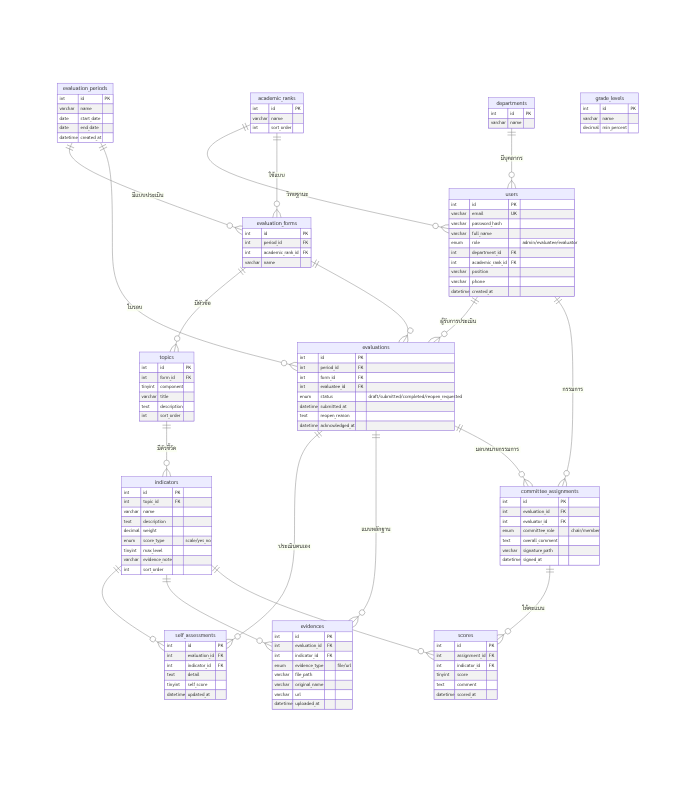 | 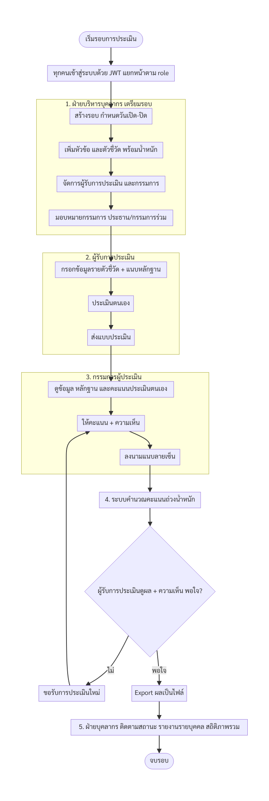 |

| เข้าสู่ระบบ | ฝ่ายบุคลากร (HR) |
|---|---|
| 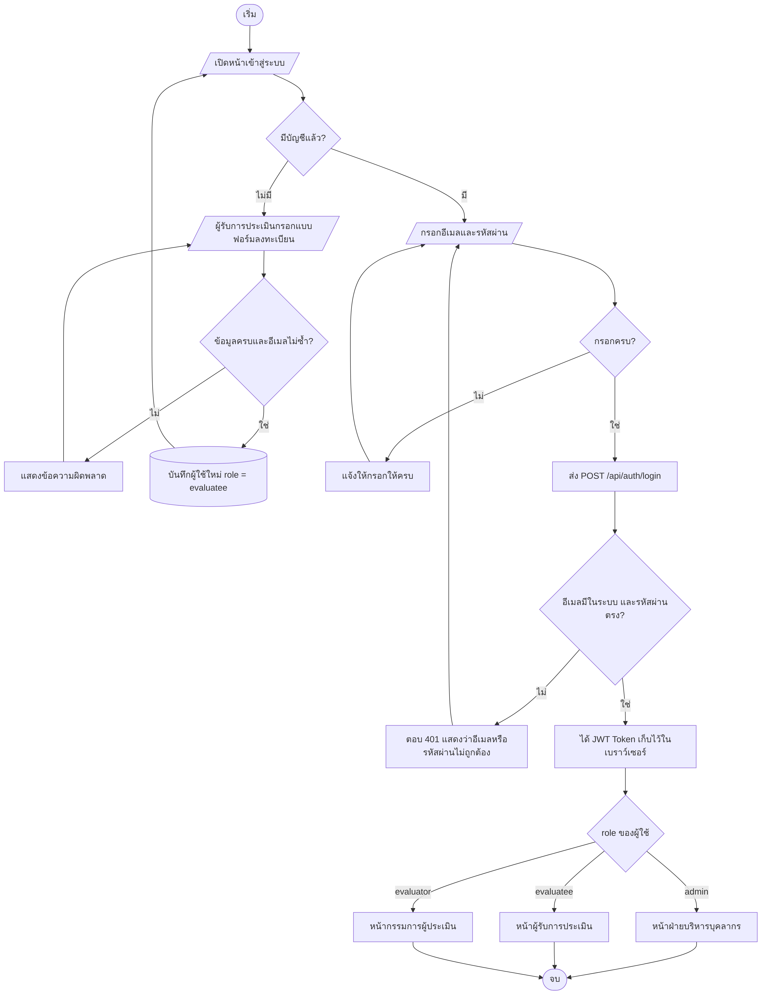 | 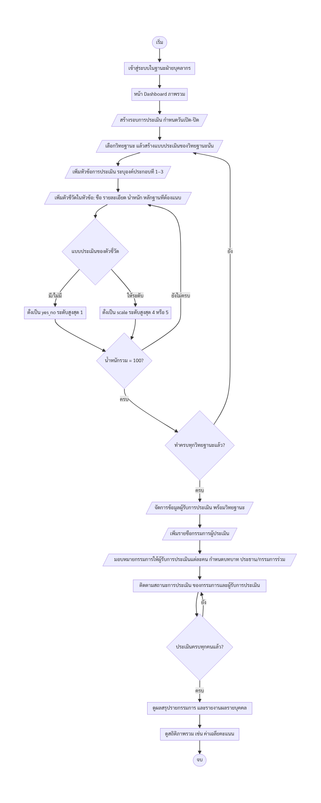 |

| ผู้รับการประเมิน | กรรมการผู้ประเมิน |
|---|---|
| 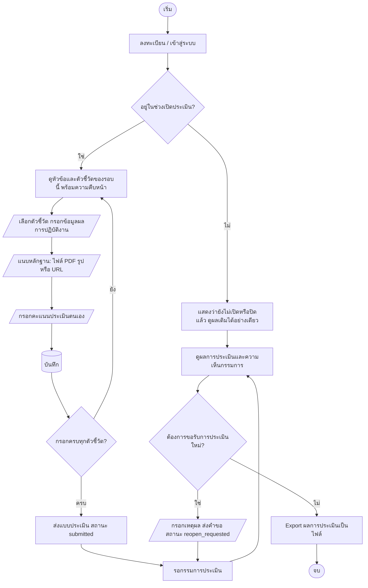 | 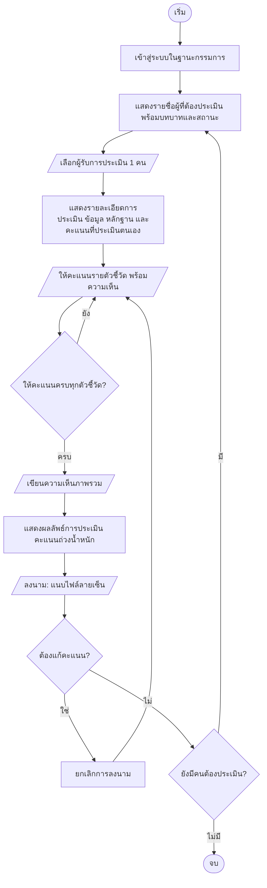 |

### หน้าจอ (`design/screens/`)

| หน้าเข้าสู่ระบบ | หน้าภาพรวม |
|---|---|
| 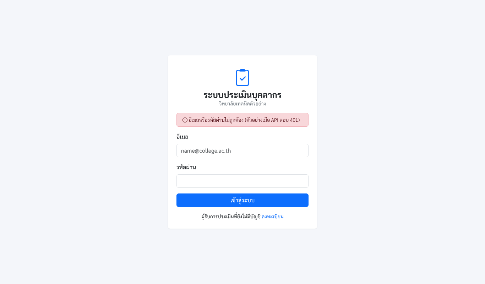 | 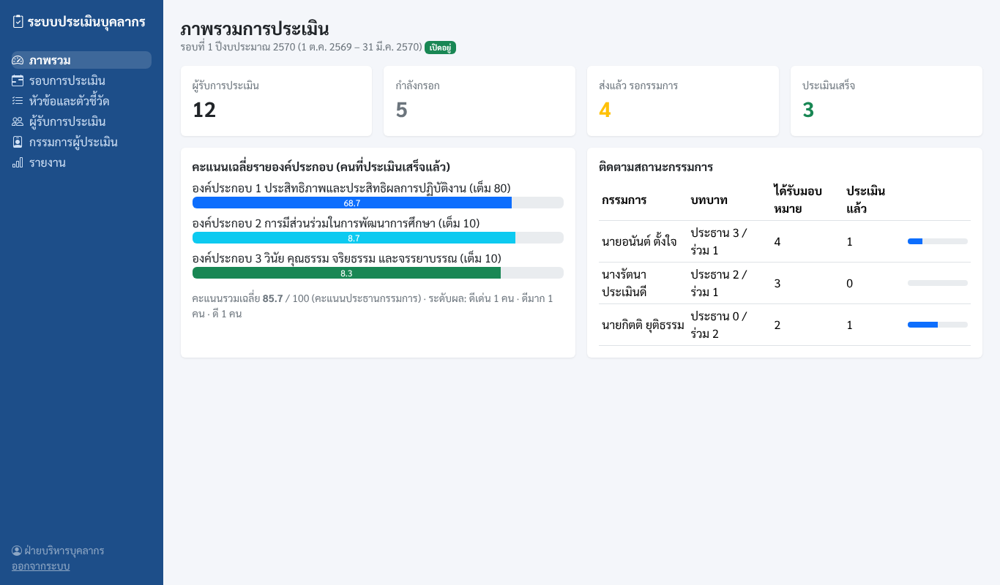 |

| หน้าฝ่ายบุคลากร | หน้าผู้รับการประเมิน |
|---|---|
| 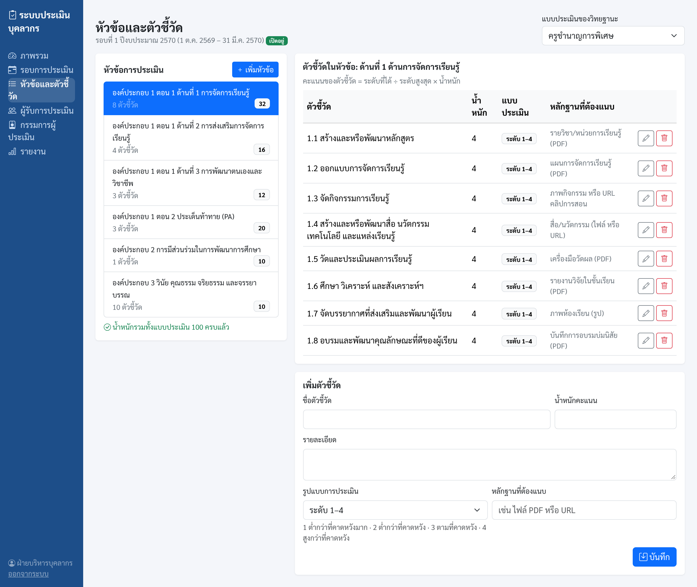 | 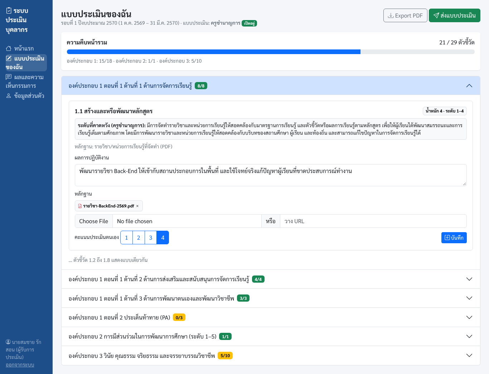 |

| หน้ากรรมการผู้ประเมิน | |
|---|---|
| 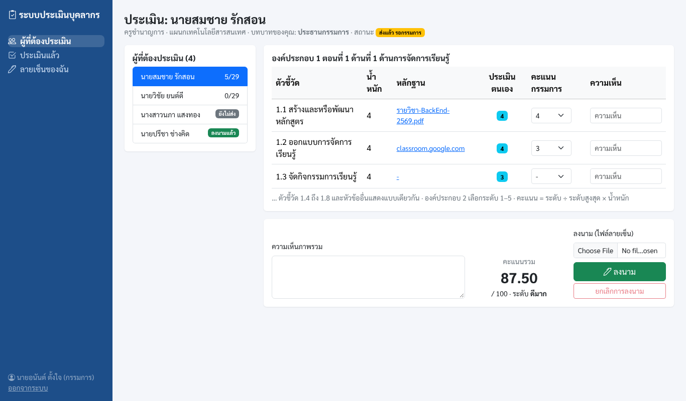 | |

## สัปดาห์ 4: คัดลอกไปใช้

คัดลอกโฟลเดอร์ `week04/data` และ `week04/public` ไปวางในโปรเจกต์ `first-server` ของตัวเอง
ให้ได้โครงแบบนี้

```
first-server/
├── data/
│   └── evaluatees.js
├── public/
│   └── index.html
└── index.js        ← เขียนเองในคาบ
```

รหัสผ่านของผู้ใช้ตัวอย่างทุกคนในฐานข้อมูลคือ `1234`

### ผลที่ควรได้ในสัปดาห์ 4 (`week04/expected/`)

| รายชื่อทั้ง 12 คน `/api/evaluatees` | ค้นหา | ไม่พบ (404) |
|---|---|---|
| 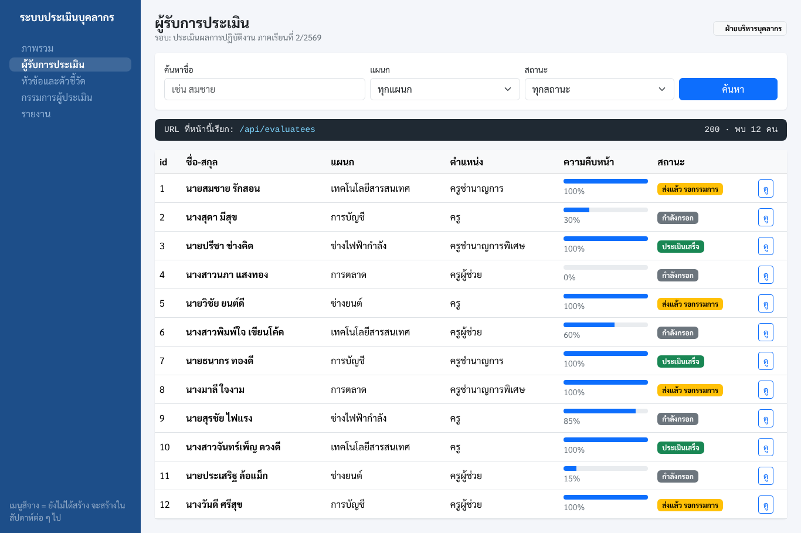 | 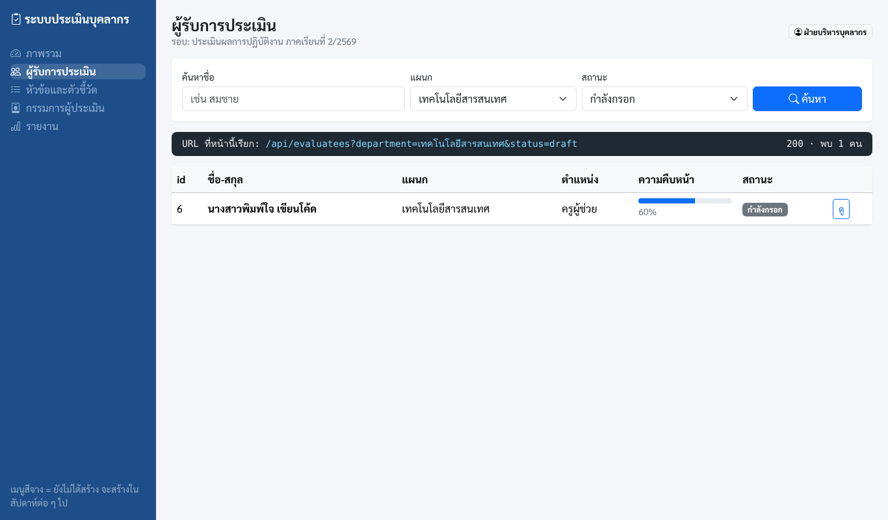 | 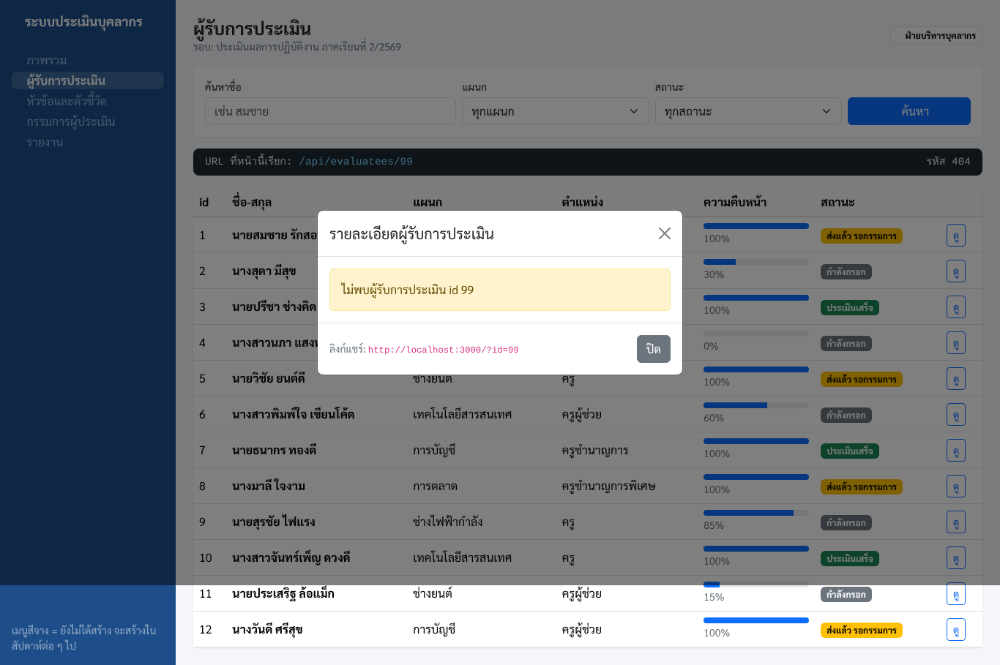 |
